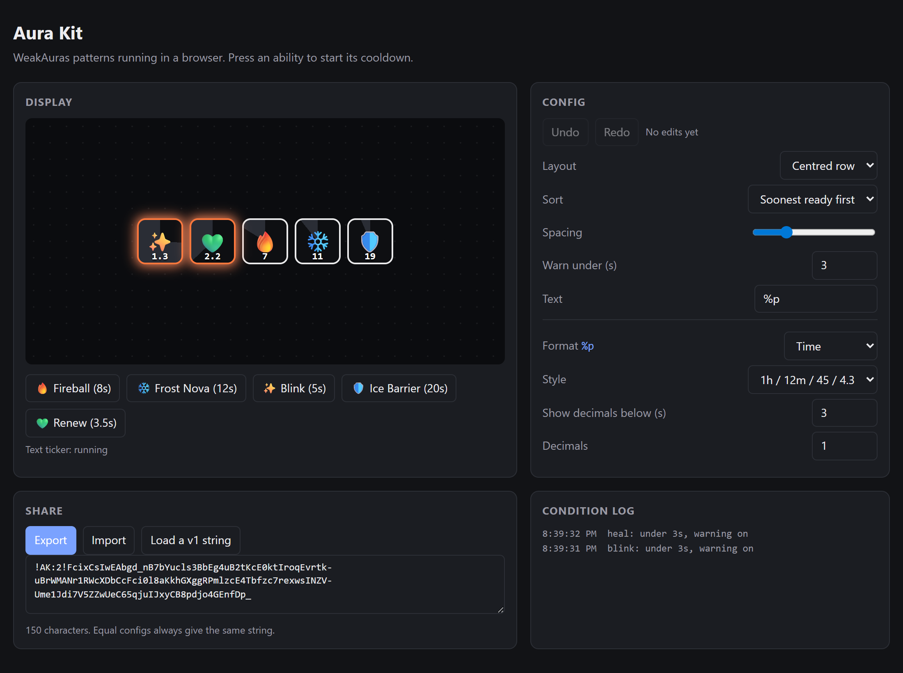

# aura-kit

The parts of the [WeakAuras](https://github.com/WeakAuras/WeakAuras2) World of Warcraft addon that work outside the game, ported from Lua to TypeScript. It has no runtime dependencies and runs in browsers and Node 18+.



*The demo (`npm run demo`): a trigger fills a state map, and each state becomes an icon that slides in. A condition turns icons orange under 3 seconds, at the exact moment rather than by polling. The group re-sorts and lays out its icons, and every config edit is undoable and exports as one short string. The format options on the right are generated from the formatter schema.*

The port was made from WeakAuras2 commit `bedea0f` (2026-10-18). WeakAuras is GPL-2.0, and so is this port: see [LICENSE](LICENSE). A project that copies this code must be GPL-2.0 too. Re-implementing the ideas yourself has no such condition.

```bash
npm install
npm test          # 31 tests
npm run demo      # cooldown-tracker demo at http://localhost:5173
```

## What WeakAuras is, in one paragraph

A player builds a "display" (an icon, a bar, some text) from **triggers** that watch game state, **conditions** that restyle the display when that state matches, and **animations** for appearing, idling and leaving. Displays nest into **groups** that lay out their children as they come and go. The whole thing is data: it saves, it exports as one string people paste into Discord, and it imports into other people's games years later. That makes it a no-code UI builder with reactive data, and that's the part that carries over to the web.

## The patterns, and where they live

| Pattern | Port | WeakAuras source | Why it's worth stealing |
|---|---|---|---|
| Subscribe with first/last hooks | [subscribable.ts](src/subscribable.ts) | `SubscribableObject.lua` | The owner hears when an event gains its first listener and loses its last, so timers, sockets and polling run only while something is listening. |
| Undo by invertible actions | [timeMachine.ts](src/timeMachine.ts) | `TimeMachine.lua` | Each edit is a small `(doc, action, path, payload)` record with a registered inverse. Undo/redo, transactions and deduplicated side effects take about 250 lines, with no snapshots of the whole document. |
| Feature flags with hydration | [features.ts](src/features.ts) | `Features.lua` | Flags register at load and are decided once settings arrive. Asking early answers "off", and toggling early throws, so nothing acts on a guess. Flags can block a document that needs them. |
| Keyed state with change tracking | [stateMap.ts](src/stateMap.ts) | `TSUHelpers.lua` | A trigger fills a map of states, one per thing to show. Writers update or replace, and the map records real changes only, so the renderer redraws just those keys. |
| Trigger combination | [triggers.ts](src/triggers.ts) | `WeakAuras.lua` | Combine with all, any, or a custom function, and choose which trigger feeds text and progress. A broken custom function hides the display; it doesn't crash it. |
| Ordered conditions that never poll | [conditions.ts](src/conditions.ts) | `Conditions.lua` | Base properties, plus active conditions laid on in order: later ones win, and a property reverts when none applies. Time checks ("under 5s left") report the exact moment they'll flip, so one timer replaces a polling loop. |
| `%placeholder` templates | [textTemplate.ts](src/textTemplate.ts) | `ReplacePlaceHolders` | `%p`, `%2.stacks`, `%{any name}`, `%%`. A four-state scanner parses once into segments, and parsing also lists the symbols used. |
| Format types: one entry drives both UI and runtime | [formatters.ts](src/formatters.ts) | `format_types` in `Types.lua` | Each format type holds its options schema *and* its formatter factory side by side, so the settings UI and the behaviour can't drift apart. The demo builds its settings panel from that schema. |
| Versioned migrations | [migrations.ts](src/migrations.ts) | `Modernize.lua` | Every saved document carries `internalVersion`, and numbered steps upgrade it in order. WeakAuras has 80+ steps since 2018. Documents from a newer version are refused, never guessed at. |
| Share strings | [transmission.ts](src/transmission.ts) | `Transmission.lua` | `!TAG:2!<deflate+base64url>`. The prefix picks the decoder, so old strings keep working. Failures name the stage that broke. Output is deterministic (sorted keys), so equal configs give equal strings. |
| Per-display script environments | [environments.ts](src/environments.ts) | `AuraEnvironment.lua` | Each display's user code gets its own env with config and a persisted `saved` slot. Envs nest on a stack, and errors are caught and reported against the display and phase. |
| One frame loop, shape functions, three phases | [animation.ts](src/animation.ts) | `Animations.lua`, `Prototypes.lua` | One rAF loop that stops when idle. Motion is progress, then easing, then a tiny shape function per channel (bounce, shake, pulse, spiral). Displays play **start** (reversed) on show, loop **main**, and play **finish** before they hide. A "relative" duration ties an animation to the display's own timer. |
| Layout factories and sorts that know their inputs | [layout.ts](src/layout.ts) | `DynamicGroup.lua` | `grower(config)` does setup once and returns a cheap layout function (row, centred, circle, grid). Sorts are composed from comparators and declare `dependsOn`, so the group re-sorts only when those fields change. |

## Using it

Each module stands alone. Import what you need:

```ts
import { ConditionRunner, ConditionScheduler } from "aura-kit/src/conditions";

const runner = new ConditionRunner({ color: "white", pulse: false }, [
  { check: { type: "remaining", trigger: 0, field: "expiresAt", op: "<", value: 10 }, changes: { color: "orange" } },
  { check: { type: "remaining", trigger: 0, field: "expiresAt", op: "<", value: 3 }, changes: { color: "red", pulse: true } },
]);

// Re-evaluates on its own at exactly t-10s and t-3s; no interval.
const scheduler = new ConditionScheduler(runner, () => [session], ({ props }) => applyStyle(props));
scheduler.evaluate();
```

Some places this fits outside games:

- **Dashboards and status boards.** Triggers are your data sources and states are rows. Conditions colour the tiles, and a dynamic group lays them out as they appear.
- **Session and token expiry banners, SLA timers, auction countdowns.** Remaining-time conditions with one exact timer each.
- **Any editor.** The TimeMachine gives you undo/redo, and migrations plus share strings let users trade presets.
- **Stream overlays** (OBS browser sources). Icons that animate in and out, `%placeholder` text, and configs viewers can import.
- **Notification stacks and toasts.** The start/main/finish lifecycle with a grow-down layout.

## Where this port differs from the Lua

- **TimeMachine** applies each record as it's appended, then takes its inverse from live data. WeakAuras computes every inverse in a transaction before applying any of them, which can undo wrongly when one transaction touches the same path twice. A transaction that throws is rolled back here.
- **Conditions** compile to closures. WeakAuras generates Lua source and loads it, and `eval` would buy nothing in JS.
- **Script environments** don't sandbox anything. Shadowing globals in JavaScript is a speed bump, not a security boundary. Run untrusted user code in a sandboxed iframe or a Worker.
- **Share strings** use JSON and the built-in `CompressionStream` instead of LibSerialize and LibDeflate. The string format isn't compatible with real WeakAuras imports.
- Everything tied to WoW is gone: the game API, combat lockdown, protected frames and taint.
